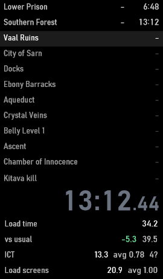

# PoE Loads for LiveSplit

Shows how much of your Path of Exile run goes to loads: **ICT** (click → loading screen) and **load screens**, live, with how this run compares to your usual pace and to NA.



## Install

1. Download `LiveSplit.PoELoads.dll` from [Releases](../../releases). Right-click → Properties → **Unblock**.
2. Put it in `LiveSplit\Components`, restart LiveSplit.
3. Edit Layout → **+** → Information → **PoE Loads**.

## My splits and layout

In [`examples`](examples). After installing the component:

1. Right-click LiveSplit → Open Splits → From File → the `.lss`.
2. Right-click LiveSplit → Open Layout → From File → the `.lsl`.
3. Edit Splits → **Activate** (autosplitter).

## Notes

- Windows, LiveSplit 1.8+, English client, windowed or borderless, 16:9.
- Reads `Client.txt` and the top of the game window. No memory reading, no input, no network.
- Every load is logged to `PoELoads\` next to `LiveSplit.exe`.

## Build

```
dotnet build src -c Release -p:LiveSplitDir="C:\path\to\LiveSplit"
```

MIT. Not affiliated with Grinding Gear Games or LiveSplit.
